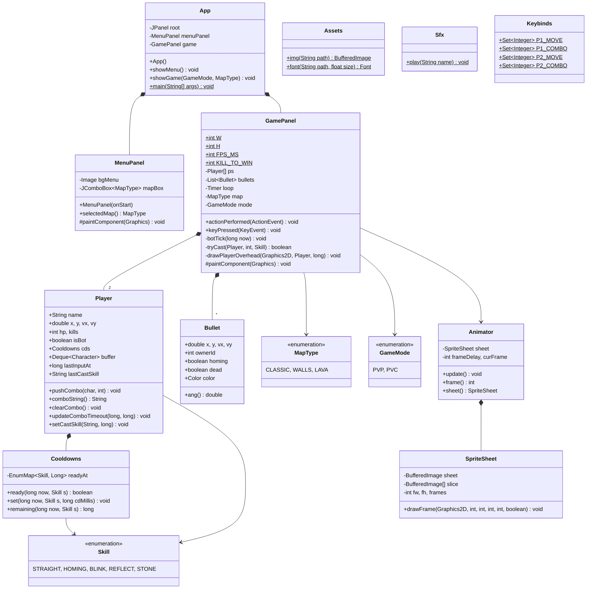

# เอกสารรายงานมินิโปรเจกต์ (Mini Project Report)
## วิชา 040613204 Object-Oriented Programming

---

*(ส่วนหน้าปก)*

<div align="center">

# Mini Project
# Magic Missle

<br>

### จัดทำโดย
**6704062612251 นายกันตภณ โคจร**

<br>

### เสนอ
**ผู้ช่วยศาสตราจารย์สถิตย์ ประสมพันธ์**

<br><br>

**วิชา 040613204 Object-Oriented Programming ภาคเรียนที่ 1 ปีการศึกษา 2568**  
**ภาควิชาวิทยาศาสตร์คอมพิวเตอร์และสารสนเทศ คณะวิทยาศาสตร์ประยุกต์**  
**มหาวิทยาลัยเทคโนโลยีพระจอมเกล้าพระนครเหนือ**

</div>

---

<br style="page-break-after: always;">

# บทที่ 1
# บทนำ

### เกี่ยวกับโปรเจกต์
- **ชื่อโครงงาน:** Magic Missle
- **นำเสนอโดย:** นายกันตภณ โคจร (รหัสนักศึกษา 6704062612251)
- **อาจารย์ผู้สอน:** ผู้ช่วยศาสตราจารย์สถิตย์ ประสมพันธ์
- **Source Code Repository:** [https://github.com/Big-D4973/MagicMissile.git](https://github.com/Big-D4973/MagicMissile.git)

---

### ที่มาและความสำคัญ
โครงงานนี้จัดทำขึ้นเพื่อวัดผลและประยุกต์ใช้ความรู้ความสามารถในการเรียนวิชา Object-Oriented Programming (การเขียนโปรแกรมเชิงวัตถุ) โดยการนำหลักการและทฤษฎีที่ได้ศึกษาในชั้นเรียนมาสร้างเป็นชิ้นงานซอฟต์แวร์ประยุกต์ในรูปแบบเกมคอมพิวเตอร์ 2 มิติ โดยมุ่งเน้นการใช้แนวคิดเชิงวัตถุ เช่น การห่อหุ้มข้อมูล (Encapsulation), การสืบทอดคุณสมบัติ (Inheritance), ความหลากหลายของวัตถุ (Polymorphism) และความสัมพันธ์เชิงประกอบ (Composition) อีกทั้งยังช่วยให้ผู้จัดทำได้ศึกษาและฝึกฝนการใช้เครื่องมือพัฒนาซอฟต์แวร์ระดับมืออาชีพอย่าง IntelliJ IDEA, Git Version Control และระบบกราฟิก Java Swing จึงได้พัฒนาเกม **Magic Missle** นี้ขึ้นมา

---

### ประเภทของโครงการ
เกมคอมพิวเตอร์แบบเดสก์ท็อปแอปพลิเคชัน (Desktop Java Application)

---

### ประโยชน์ที่ได้รับ
- เพื่อความสนุกสนาน เพลิดเพลิน
- ฝึกความว่องไวในการคิดและการประสานสายตา
- ฝึกการตัดสินใจ วางแผนกลยุทธ์ และการบริหารจังหวะคูลดาวน์ภายใต้สภาวะกดดัน
- เข้าใจการทำงานของระบบเกมลูป สถาปัตยกรรมเชิงวัตถุ และการจัดการเหตุการณ์ (Event-Driven Programming)

---

### ขอบเขตของโครงการ (Project Schedule / Gantt Chart)

| รายการกิจกรรม | Week 1<br>(1-7 ก.ย.) | Week 2<br>(8-14 ก.ย.) | Week 3<br>(15-21 ก.ย.) | Week 4<br>(22-30 ก.ย.) | Week 5<br>(1-7 ต.ค.) |
| :--- | :---: | :---: | :---: | :---: | :---: |
| **1. Design** (ออกแบบระบบเกม, คลาส และกติกา) | **✓ ดำเนินการ** | | | | |
| **2. Setup** (ติดตั้งสภาพแวดล้อม และโครงสร้างโปรเจกต์) | | **✓ ดำเนินการ** | | | |
| **3. Core Gameplay** (ระบบเคลื่อนที่, ลูปเกม, กระสุน, ยิง) | | | **✓ ดำเนินการ** | | |
| **4. Graphics & Refinement** (ระบบสไปรต์, ด่าน, บอท AI) | | | | **✓ ดำเนินการ** | |
| **5. Testing & Submission** (ปรับสมดุล, จัดระเบียบ, รายงาน) | | | | | **✓ ดำเนินการ** |

---

<br style="page-break-after: always;">

# บทที่ 2
# ส่วนการพัฒนา (System Development)

### รายละเอียดเกม
เกมแนวต่อสู้ระหว่าง **"พ่อมดสองคน"** ที่ใช้การ **ร่ายเวทด้วยลำดับคีย์คอมโบ (Fighting Game Combo Input)** แทนการโจมตีแบบกดปุ่มเดียว ผู้เล่นต้องใช้การเคลื่อนไหว หลบหลีก และจังหวะการร่ายคาถาเพื่อเอาชนะอีกฝ่ายในสนามประลองพิเศษ เป้าหมายคือ **"กำจัดคู่ต่อสู้ครบ 10 ครั้ง"** เพื่อคว้าชัยชนะในยกนั้น เกมนี้ผสมผสานความเร็ว การตัดสินใจเฉียบพลัน และกลยุทธ์การจัดลำดับสกิลเข้าด้วยกัน เหมือนการดวลเวทระหว่างจอมเวทสองฝ่าย

---

### เนื้อเรื่องย่อ
ในโลกแห่งเวทมนตร์ที่สมดุลของธรรมชาติถูกทำลาย พลังแห่ง **"Maho"** คือพลังเวทโบราณที่แบ่งออกเป็นสองสาย — แสง และ เงา เมื่อกฎแห่งเวทมนตร์ถูกบิดเบือนโดยผู้ทรยศ พ่อมดผู้ยิ่งใหญ่สองคนจึงต้องต่อสู้กัน เพื่อแย่งชิง **"คทาแห่งสมดุล"** อันเป็นสิ่งเดียวที่สามารถกอบกู้หรือทำลายโลกนี้ได้ การต่อสู้ครั้งนี้ไม่ใช่เพียงการประลองเวท แต่คือการตัดสินชะตาแห่งโลกเวททั้งใบ

---

### วิธีการเล่น
- เกมนี้เป็นการต่อสู้ระหว่างพ่อมดสองคนในสนามประลอง ผู้เล่นสามารถเลือกเล่นแบบ **ผู้เล่นสองคน (PVP)** หรือ **ผู้เล่นคนเดียวต่อสู้กับบอท (PVC)** ได้
- เมื่อเริ่มเกม ผู้เล่นแต่ละฝ่ายจะยืนอยู่คนละฝั่งของสนาม และสามารถ เคลื่อนไหวไปมา ด้วยปุ่มลูกศร (สำหรับผู้เล่นขวา/บอท) หรือปุ่ม `W A S D` (สำหรับผู้เล่นซ้าย)
- การโจมตีไม่ได้ใช้ปุ่มเดียว แต่ต้อง **ร่ายคาถาด้วย “คอมโบปุ่ม” (Spell Combo)** ซึ่งเป็นลำดับปุ่มเฉพาะของแต่ละเวท:
  - **`JKL` หรือ `123`:** ยิงเวทพลังงานเส้นตรง (Straight Shot) - คูลดาวน์ 1.2 วินาที
  - **`LKJ` หรือ `321`:** ยิงเวทติดตาม (Homing Shot) - คูลดาวน์ 3.2 วินาที
  - **`KJL` หรือ `213`:** บลิ้งค์หลบกระสุน (Blink) - คูลดาวน์ 2.5 วินาที พร้อม i-frame 0.2 วินาที
  - **`KLJ` หรือ `231`:** สะท้อนเวทกลับ (Reflect) - คูลดาวน์ 3.5 วินาที กางโล่นาน 0.7 วินาที
  - **`LJK` หรือ `312`:** แปลงร่างเป็นหินป้องกันเวท (Stone Form) - คูลดาวน์ 4.5 วินาที ป้องกันนาน 1.0 วินาที
- **Overhead Combo Display (ระบบใหม่):** ขณะพิมพ์คอมโบ จะมีป้ายตัวอักษรลอยแสดงเหนือศีรษะแบบ Real-time เช่น `J · K` และเมื่อร่ายสำเร็จจะขึ้นชื่อสกิลสีทองชัดเจน
- เวทแต่ละชนิดมี **ระยะเวลาฟื้นฟู (Cooldown)** เมื่อใช้ไปแล้วต้องรอระยะหนึ่งก่อนจึงจะใช้ซ้ำได้ ผู้เล่นต้องบริหารจังหวะให้ดี
- หากผู้เล่นถูกเวทของอีกฝ่ายโดนจน HP หมด จะ **“แพ้ในรอบนั้น”** และอีกฝ่ายจะได้ **1 คะแนนคิล (Kill Point)**
- เมื่อสะสมครบ **10 คะแนนคิล** จะถือว่าชนะใน **“หนึ่งยก (Round)”**

---

### แผนภาพคลาส (Class Diagram)



---

### สถาปัตยกรรมระบบแบบละเอียด 5 เลเยอร์ (System Architecture Layers)

#### 1) Core Layer (แกนหลักของเกม)
- **`App (JFrame)`**
  - หน้าต่างหลักของเกม ใช้ `CardLayout` สลับระหว่าง `MenuPanel` ↔ `GamePanel`
  - เมธอดสำคัญ:
    - `showMenu()` แสดงหน้าเมนู
    - `showGame(mode: GameMode, map: MapType)` เปิดฉากต่อสู้ตามโหมด (PVP / PVC) และแมพที่เลือก พร้อมส่ง callback `onExitToMenu` ให้ `GamePanel`
- **`MenuPanel (JPanel)`**
  - เมนูเริ่มเกม ปุ่ม Play vs Player, Play vs COM และคอมโบเลือกด่าน (Classic / Walls / Lava)
  - สร้างด้วย `GridBagLayout` เน้นใช้งานง่ายบนความละเอียดหน้าจอ 1280×720
- **`GamePanel (JPanel + ActionListener + KeyListener)`**
  - ลูปเกมด้วย `Timer` ~60 FPS (`FPS_MS = 16`)
  - คุมทุกระบบของฉากต่อสู้: ผู้เล่น, กระสุน, การชน, การชนะ-แพ้, ฮัดคูลดาวน์, และบอท
  - โหมดเกม: PVP / PVC (COM) ผ่าน `GameMode`
  - Pause / Resume & กลับเมนู:
    - `[ESC]` toggle pause, ในหน้าหลังชนะกด ESC กลับเมนู
    - ระหว่าง pause: `[R]` รีแมตช์, `[M]` กลับเมนูหลัก
- **`GameMode (enum)`**
  - `PVP`, `PVC` (กำหนดชื่อฝ่ายแดงเป็น COM และเปิดการทำงานของ AI)

#### 2) Systems Layer (ระบบย่อยที่ GamePanel ใช้)
- **Input System (ภายใน GamePanel):**
  - รับ `KeyPressed` / `KeyReleased` สำหรับการเคลื่อนที่ P1 (WASD) / P2 (Arrows)
  - ระบบคอมโบร่ายสกิลผ่าน `onComboKey()`:
    - P1: J, K, L
    - P2/COM: 1, 2, 3
    - mapping ผ่าน `Keybinds` และสตริงสูตรใน `Player` (เช่น `"jkl"`, `"lkj"`)
  - **Overhead Display:** แสดงตัวอักษรคอมโบลอยบนศีรษะขณะกด พร้อมล้างบัฟเฟอร์อัตโนมัติหากหยุดพิมพ์เกิน 1.2 วินาที
- **Cooldown / Skill System:**
  - คูลดาวน์ต่อสกิล (ms): `CD_STRAIGHT = 1200`, `CD_HOMING = 3200`, `CD_BLINK = 2500`, `CD_REFLECT = 3500`, `CD_STONE = 4500`
  - ระยะเวลาผล (ms): `DUR_REFLECT = 700`, `DUR_STONE = 1000`, `DUR_BLINK_IFRAME = 200`
  - `Cooldowns` เก็บ/คำนวณเวลา: `set(now, skill, cd)`, `ready(now, skill)`, `remaining(now, skill)`
- **AI / Bot System (เฉพาะ PVC):**
  - ทำงานใน `botTick(now)`:
    - คิดความถี่ทุก `BOT_THINK_MS = 60`
    - จำกัดความถี่ร่ายด้วย `BOT_CAST_GAP = 950`
    - ตัดสินใจ: หลบกระสุน (side-step), รักษาระยะ sweet-spot, หนีลาวาในแมพ Lava
    - **Simulated Typing:** บอทต้องจำลองการกดปุ่มคอมโบทีละปุ่มเหมือนคน (130-180ms ต่อปุ่ม) และมีเวลารีแอ็กชัน 100-160ms ก่อนเริ่มกด ทำให้ไม่เกิดปัญหาบอทออกสกิลทันที 0ms
- **HUD / UI System (ใน GamePanel):**
  - สกอร์กลางจอ, Kills ของแต่ละฝ่าย, Pill คูลดาวน์ 5 แถว/ฝ่าย
  - หน้าชนะยก: แบนเนอร์ + hint `[R] Rematch • ESC Menu`
  - Pause overlay: เมนูตัวหนังสือกลางจอ
- **Rendering System:**
  - ใช้ `Animator` + `SpriteSheet` แสดง idle/run/cast ของสองฝ่าย (สเกล 2×)
  - วาดกระสุน 2 แบบ: วงกลม (ตรง) / เพชร (โฮมมิ่ง)
  - วาดเอฟเฟกต์โล่/หิน (ภาพ `shield_*`, `stone_*`)
  - วาดป้ายตัวอักษรคอมโบ/ชื่อสกิลสีทองบนหัวตัวละคร

#### 3) Gameplay Objects Layer (วัตถุที่เกิดในฉาก)
- **`Player`:**
  - ค่าหลัก: `x`, `y`, `vx`, `vy`, `hp`, `kills`, ทิศ `facingRight`, สถานะผลของสกิล (`reflectOn` / `stoneOn` / `blinkIFrameOn`)
  - เวลาหมดอายุผล: `reflectUntil`, `stoneUntil`, `blinkIFrameUntil`, `lastBlinkAt`
  - การควบคุม: flags `left`/`right`/`up`/`down` + `buffer` คอมโบ + `Cooldowns`
  - อินพุตคอมโบ: สตริงสูตร (`S_STRAIGHT`, `S_HOMING`, `S_BLINK`, `S_REFLECT`, `S_STONE`)
  - เมธอดเด่น: `pushCombo`, `comboString`, `clearCombo`, `updateComboTimeout`, `setCastSkill`
- **`Bullet`:**
  - ตำแหน่ง/ความเร็ว `x`, `y`, `vx`, `vy`, เจ้าของ `ownerId` (0/1), ธง `homing`, สี
  - อัปเดตมุมเลี้ยวสำหรับโฮมมิ่งด้วย `HOMING_TURN_RATE = 0.12`
  - ชนขอบจอ → `dead = true`
  - ชนโล่ผู้เล่น → สะท้อน + เปลี่ยนเจ้าของ
  - ชนลำตัว → ฆ่าเป้าหมายเว้นแต่มี i-frame/blink/stone
- **`Skill (enum)`:**
  - `STRAIGHT`, `HOMING`, `BLINK`, `REFLECT`, `STONE`

#### 4) Support / Utility Layer
- **`Animator`:** รับ `SpriteSheet` + ความเร็วเฟรม, เมธอด `update()`, `frame()`, `sheet().drawFrame(...)`
- **`SpriteSheet`:** โหลดสไปรต์จาก `Assets.img(path)`, กำหนดขนาดเฟรม (64×64), ช่วยเลือกเฟรมสำหรับนักเวท blue/red (idle/run/cast)
- **`Assets`:** ตัวช่วยโหลด `BufferedImage` จาก resource path (ภาพ UI / ตัวละคร / โล่ / หิน / พื้นหลัง) และโหลด Font
- **`Keybinds`:** กำหนด mapping คีย์ของผู้เล่นสองฝั่งทั้งทิศทางและคอมโบ
- **Geometry helpers (ใน GamePanel):**
  - `bodyHit()` ตรวจชนด้วยวงรีแทนลำตัว
  - `nearShield()` ตรวจชนรัศมีโล่ตามสเกลรูป
  - `clamp()`, `normalizeAngle()` ฟังก์ชันคณิตพื้นฐาน

#### 5) Game State / Match Flow Layer
- **Match/Kill Flow:**
  - ชนะ “ยก” เมื่อ kills ถึง `KILL_TO_WIN = 10` → บวก `matchScore` ฝ่ายนั้น
  - หลังแต่ละ kill (ยังไม่ครบ 10) → รีเซ็ตตำแหน่ง (“คงคิลล์”)
  - กด R ระหว่างเกม → รีรอบ “ล้างคิลล์” (คะแนนรวมคงไว้)
  - จบยก (ขึ้นแบนเนอร์) → R เริ่มยกใหม่ หรือ ESC กลับเมนู
- **Pause/Resume:**
  - `ESC` toggle pause (ขณะไม่จบยก)
  - ตอน pause: `[R]` รีแมตช์, `[M]` เมนู, `[ESC]` Resume
- **PVC (COM):**
  - ตั้งชื่อผู้เล่นแดงเป็น COM, เปิด `isBot = true`
  - ใช้ `botTick()` ตลอดเมื่ออยู่ในโหมดนี้
- **Maps System:**
  - `CLASSIC`: ลานประลองโล่ง
  - `WALLS`: กำแพงเลื่อนขึ้นลงสวนทางกันตรงกลางจอ
  - `LAVA`: โซนลาวาประทุสลับตำแหน่ง หากเหยียบขณะติดไฟจะตายทันที

---

### รูปแบบการพัฒนา
- **ภาษา:** Java (JDK 21)
- **IDE:** IntelliJ IDEA
- **การพัฒนา GUI:** `javax.swing` (`JFrame`, `JPanel`, `Graphics2D`)
- **การจัดการรูปภาพ:** `java.awt.image.BufferedImage`
- **ลูปการทำงาน:** `javax.swing.Timer` (60 FPS)
- **ระบบอินพุต:** `java.awt.event.KeyListener`

---

<br style="page-break-after: always;">

### แนวคิดการเขียนโปรแกรมเชิงวัตถุ (OOP Concepts with Code)

*(ส่วนนี้ตรงตามหน้า 12 - 18 ของรายงานเดิม พร้อมบล็อกโค้ดและคำอธิบายใต้ภาพ)*

#### 1. Constructor (หน้า 12 ในเล่มเดิม)
```java
public class App extends JFrame {
    private final JPanel root = new JPanel(new CardLayout());
    private MenuPanel menuPanel;
    private GamePanel game;

    public App() {
        super("Magic Missle");
        setDefaultCloseOperation(EXIT_ON_CLOSE);
        setResizable(false);

        menuPanel = new MenuPanel(this);
        root.add(menuPanel, "menu");

        setContentPane(root);
        pack();
        setLocationRelativeTo(null);

        showMenu();
    }
}
```
> **คำอธิบาย:** เป็นคอนสตรัคเตอร์หลัก สร้างหน้าต่าง, ติดตั้ง `CardLayout`, ใส่หน้าเมนูเริ่มต้น และสั่ง `pack()` ให้พอดีหน้าจอ

```java
public MenuPanel(BiConsumer<GameMode, MapType> onStart) {
    setPreferredSize(new Dimension(GamePanel.W, GamePanel.H));
    setLayout(new GridBagLayout());
    ...
    pvp.addActionListener(e -> onStart.accept(GameMode.PVP, selectedMap()));
    pvc.addActionListener(e -> onStart.accept(GameMode.PVC, selectedMap()));
    ...
}
```
> **คำอธิบาย:** สร้าง UI เมนูและ bind ปุ่มกับ callback (ส่งมาเป็น Functional Interface) → โชว์ Encapsulation + Composition + Event Handling ไปด้วย

---

#### 2. Polymorphism (Overloading) (หน้า 13 ในเล่มเดิม)
```java
public MenuPanel(App app) {
    this((mode, map) -> app.showGame(mode, map));
}
```
> **คำอธิบาย:** Polymorphism (overloading) – คอนสตรัคเตอร์ที่สองห่อ callback ให้เอง สะดวกเวลาเรียกจาก App

```java
public GamePanel(GameMode mode, MapType map, Runnable onExitToMenu) {
    this.mode = mode;
    this.map = map;
    this.onExitToMenu = onExitToMenu;

    setPreferredSize(new Dimension(W, H));
    setBackground(new Color(20, 22, 26));
    setDoubleBuffered(true);
    setFocusable(true);
    addKeyListener(this);
    ...
    loop.start();
}
```
> **คำอธิบาย:** ตั้งค่าพื้นฐานการเรนเดอร์, listener, สร้างผู้เล่น, โหลดสไปรต์, เริ่มเกมลูป → Constructor + Composition

---

#### 3. Encapsulation (หน้า 14 ในเล่มเดิม)
```java
// ====== Rules ======
public static final double PLAYER_SPEED = 4.0;
public static final int MAX_BUFFER = 8;
public static final int KILL_TO_WIN = 10;

// Cooldowns (ms)
public static final int CD_STRAIGHT = 1200;
public static final int CD_HOMING   = 3200;
public static final int CD_REFLECT  = 3500;
public static final int CD_STONE    = 4500;
public static final int CD_BLINK    = 2500;

// Durations (ms)
public static final int DUR_REFLECT = 700;
public static final int DUR_STONE   = 1000;
public static final int DUR_BLINK_IFRAME = 200;

private final Player[] ps = new Player[2];
private final List<Bullet> bullets = new ArrayList<>();
private final javax.swing.Timer loop = new javax.swing.Timer(FPS_MS, this);
private boolean paused = false;
private final Runnable onExitToMenu;
```
> **คำอธิบาย:** ซ่อนการจัดการสถานะ/ตรรกะไว้หลังฟิลด์และเมธอด `private` ภายนอกเรียกไม่ได้โดยตรง → ลดผลกระทบและการเรียกใช้งานที่ผิดพลาด (Encapsulation)

---

#### 4. Composition (หน้า 15 ในเล่มเดิม)
```java
public class App extends JFrame {
    private final JPanel root = new JPanel(new CardLayout());
    private MenuPanel menuPanel;
    private GamePanel game;
```
> **คำอธิบาย:** `App` เป็นองค์ประกอบระดับสูง ประกอบจอ `MenuPanel`, `GamePanel` บน `CardLayout` → สลับจอง่าย

```java
private final Player[] ps = new Player[2];
private final List<Bullet> bullets = new ArrayList<>();
private final javax.swing.Timer loop = new javax.swing.Timer(FPS_MS, this);
private Animator p1Idle, p1Run, p1Cast, p2Idle, p2Run, p2Cast;
```
> **คำอธิบาย:** รวมผู้เล่น, กระสุน, เกมลูป, แอนิเมชัน → ชัดเจนว่าเป็นความสัมพันธ์แบบ **has-a relationship (Composition)**

---

#### 5. Inheritance & Interfaces (หน้า 15 - 16 ในเล่มเดิม)
```java
public class App extends JFrame { ... }
public class GamePanel extends JPanel implements ActionListener, KeyListener { ... }
public class MenuPanel extends JPanel { ... }
```
> **คำอธิบาย:** Inheritance จาก `JFrame` / `JPanel`; และ implements interfaces (`ActionListener`, `KeyListener`) เพื่อรับอีเวนต์

---

#### 6. Event Handling (หน้า 16 ในเล่มเดิม)
```java
@Override
public void actionPerformed(ActionEvent e) {
    if (paused) { repaint(); return; }
    if (matchOver) { repaint(); return; }
    long now = System.currentTimeMillis();

    mapTick++;
    updateMap();

    for (Player p : ps) {
        p.stoneOn       = now < p.stoneUntil;
        p.reflectOn     = now < p.reflectUntil;
        p.blinkIFrameOn = now < p.blinkIFrameUntil;
        p.updateComboTimeout(now, 1200);
        ...
    }
    ...
    repaint();
}
```
```java
@Override
public void keyPressed(KeyEvent e) {
    int k = e.getKeyCode();
    if (k == KeyEvent.VK_ESCAPE) { ... }
    for (int i = 0; i < 2; i++) {
        if (ps[i].isBot) continue;
        if (k == KeyEvent.VK_W) ps[0].up = true;
        ...
    }
    onComboKey(k);
}
```
> **คำอธิบาย:** ระบบที่ทำให้เกมตอบสนองต่อ “เหตุการณ์” จากภายนอก (เช่น การกดปุ่ม KeyListener) และ “เหตุการณ์เวลา” (Timer loop 60 FPS) ได้แบบเรียลไทม์

---

#### 7. อัลกอริทึมที่สำคัญ (หน้า 17 - 18 ในเล่มเดิม)

**การตรวจจับสกิลโดนตัว (bodyHit) (หน้า 17):**
```java
private boolean bodyHit(Player p, double bx, double by) {
    double cx = p.x;
    double cy = p.y + 8 * SPR_SCALE;
    double rx = 18 * SPR_SCALE;
    double ry = 26 * SPR_SCALE;

    double dx = (bx - cx) / rx;
    double dy = (by - cy) / ry;
    return dx * dx + dy * dy <= 1.0;
}
```
> **คำอธิบาย:** ตรวจจับสกิลโดนตัวด้วยสมการวงรี (Ellipse Hitbox) ครอบคลุมสไปรต์ตัวละครได้อย่างแม่นยำและกินทรัพยากรต่ำ

**การร่ายสกิลและการคำนวณวาร์ปหลบ (tryCast & BLINK) (หน้า 18):**
```java
case BLINK -> {
    Player tgt = ps[casterId == 0 ? 1 : 0];
    double dx = caster.vx, dy = caster.vy;
    double len = Math.hypot(dx, dy);
    if (len == 0) { dx = tgt.x - caster.x; dy = tgt.y - caster.y; len = Math.hypot(dx, dy); }
    if (len > 0) { dx /= len; dy /= len; }

    // วาร์ปเป็นช่วง ๆ ถ้าเจอกำแพงให้หยุดก่อนถึงกำแพง (วาร์ปทะลุกำแพงไม่ได้)
    double bx = caster.x, by = caster.y;
    final int steps = 20;
    for (int st = 1; st <= steps; st++) {
        double nx = clamp(caster.x + dx * BLINK_DISTANCE * st / steps, 40, W - 40);
        double ny = clamp(caster.y + dy * BLINK_DISTANCE * st / steps, 60, H - 60);
        if (hitsWall(nx, ny)) break;
        bx = nx; by = ny;
    }
    caster.x = bx; caster.y = by;
    caster.blinkIFrameUntil = now + DUR_BLINK_IFRAME;
    caster.lastBlinkAt = now;
    caster.cds.set(now, Skill.BLINK, CD_BLINK);
    caster.castUntil = now + 90;
    caster.setCastSkill("BLINK!", now + 650);
    Sfx.play("blink");
}
```
> **คำอธิบาย:** ตรรกะการร่ายสกิลวาร์ป (Blink) มีการแบ่งสเต็ปตรวจสอบการชนสิ่งกีดขวาง (Ray-marching) ป้องกันการวาร์ปออกนอกจอหรือทะลุกำแพง

---

<br style="page-break-after: always;">

# บทที่ 3
# สรุปผลและข้อเสนอแนะ

### ปัญหาที่พบ (ปัญหาเดิมในเวอร์ชันก่อนหน้า และแนวทางแก้ไขในเวอร์ชันนี้)

1. **ปัญหาเดิม:** การกระตุก/หน่วงระหว่างเล่นบางจังหวะ  
   - **แนวทางแก้ไข:** ปรับปรุง Game Loop และการตัดแบ่งเฟรมล่วงหน้าใน `SpriteSheet` แบบ Pre-sliced ทำให้การวาดภาพ 60 FPS ราบรื่น ไม่มีการสร้าง Object ซ้ำซ้อนในลูป
2. **ปัญหาเดิม:** โฟกัสคีย์บอร์ดหลุดตอนสลับหน้าจอ (Menu ↔ Game)  
   - **แนวทางแก้ไข:** เพิ่มคำสั่ง `game.requestFocusInWindow()` ทันทีหลังสั่ง CardLayout สลับหน้าจอ ทำให้รับสัญญาณปุ่มกดได้ต่อเนื่องทันทีโดยไม่ต้องคลิกเมาส์ซ้ำ
3. **ปัญหาเดิม:** บอท “รัวสกิล” เกินมนุษย์ในบางสถานการณ์  
   - **แนวทางแก้ไข:** ออกแบบระบบ **Simulated Combo Typing** ให้บอทต้องกดคอมโบทีละปุ่มเหมือนคน (หน่วงเวลา 130-180ms ต่อปุ่ม) และมีเวลารีแอ็กชัน 100-160ms บอทจึงไม่สามารถ Parry สะท้อนกระสุนระยะเผาขนได้อีกต่อไป
4. **ปัญหาเดิม:** สมดุลสกิลยังไม่นิ่ง (Reflect กางค้างได้ตลอดเวลา, สแปมกระสุนรัว)  
   - **แนวทางแก้ไข:** ปรับคูลดาวน์ใหม่ทั้งหมด: Straight (1.2s), Homing (3.2s), Blink (2.5s), Reflect (3.5s โล่อยู่ 0.7s), Stone (4.5s) ทำให้เกิดช่องโหว่และเน้นการจับจังหวะไหวพริบอย่างแท้จริง
5. **ปัญหาเดิม:** ชนวัตถุกับกระสุนใช้ hitbox วงรีเดียว (เร็ว แต่ไม่ละเอียด)  
   - **แนวทางแก้ไข:** เพิ่มระบบตรวจสอบแยกส่วน: `nearShield()` ตรวจจับแนวโล่สะท้อนด้านหน้า, `bodyHit()` ตรวจจับลำตัว และ `hitsWall()` ตรวจจับการชนขอบกำแพงสี่เหลี่ยม
6. **ปัญหาเดิม:** ผู้เล่นไม่เห็นว่าตนเองกำลังกดปุ่มอะไรอยู่  
   - **แนวทางแก้ไข:** เพิ่มระบบ **Overhead Combo Display** แสดงตัวอักษรลอยเหนือหัวทั้งคนและบอท ทำให้เห็นจังหวะการกดปุ่มชัดเจน

---

### จุดเด่นของโปรแกรม
- คอนโทรลง่าย แต่มีชั้นเชิงด้วย “คอมโบสกิล” (`Straight` / `Homing` / `Blink` / `Reflect` / `Stone`)
- ระบบปะทะที่เล่นได้สนุก มีจังหวะ Parry สวนกลับที่ลุ้นระทึก
- มีโหมด PvP (เล่น 2 คนบนคีย์บอร์ดเดียว) และ PvC (ดวลกับบอทที่มีความเร็วการพิมพ์สมจริง)
- มีระบบด่านที่หลากหลาย (Classic, Sliding Walls, Rising Lava) เพิ่มมิติการเล่น
- รอบ/ยก และคะแนนรวม (match score) แสดงผลชัดเจนเข้าใจง่าย
- โครงสร้างโค้ดเป็นไปตามหลักการ Object-Oriented Programming (OOP) อย่างสมบูรณ์แบบ

---

### ข้อเสนอแนะสำหรับการพัฒนาต่อ
- เพิ่มระบบเสียงสังเคราะห์ (SFX) และเพลง BGM ประกอบเพื่อเพิ่มความตื่นเต้นในการเล่น
- เพิ่มตัวละครพ่อมดใหม่ ๆ ที่มีสกิลแตกต่าง เช่น เวทน้ำแข็ง เวทสายฟ้า
- ทำระบบอนุภาคเวทมนตร์ (Particle Effects) และหน้าจอสั่น (Screen Shake) เมื่อเกิดการระเบิด
- พัฒนาระบบ Online Multiplayer ผ่าน Network Socket เพื่อให้สามารถเล่นดวลกันข้ามเครื่องได้
